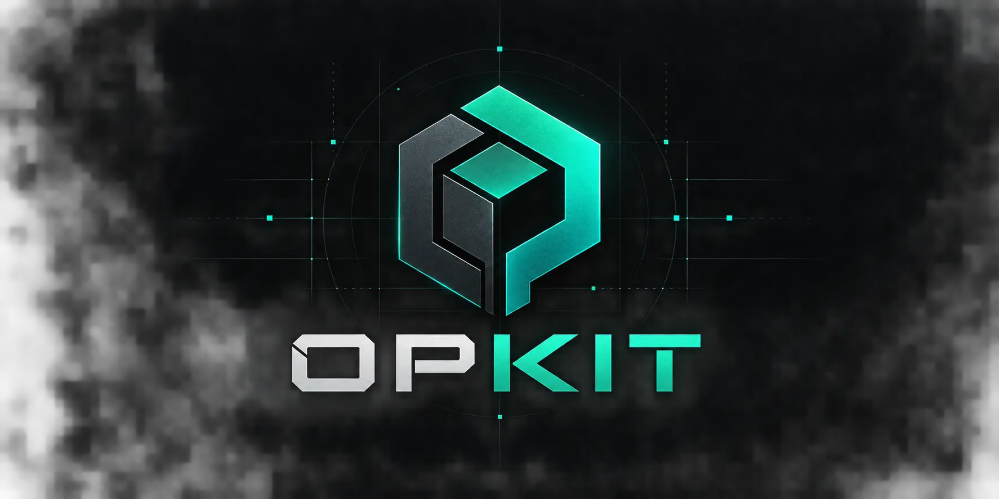

<p align="center">
  
</p>

# OPKIT — Cybersecurity Reference & Command Cheatsheets

> **Built for the terminal. Structured for speed.**  
> A fast, zero-dependency, offline-ready reference platform for penetration testers, security engineers, and CTF competitors operating in authorized lab environments.

---

## 🛠 Included Security Tools

| Tool | Category | Binary / Type | Key Capabilities Documented |
|---|---|---|---|
| **[Nmap](tools/nmap.html)** | Reconnaissance | `nmap` | Host discovery, port scanning, service versioning, OS detection, NSE vulnerability scripts |
| **[Hydra](tools/hydra.html)** | Auth & Cracking | `hydra` | Parallel brute-forcing across SSH, FTP, HTTP POST/GET forms, RDP, MySQL, SMB |
| **[Metasploit](tools/metasploit.html)** | Exploitation | `msfconsole` | Module searching, handler listeners, staged Meterpreter payloads, msfvenom generation |
| **[ffuf](tools/ffuf.html)** | Web Application | `ffuf` | Directory & file discovery, parameter fuzzing, vhost brute-forcing, status/regex filtering |
| **[Gobuster](tools/gobuster.html)** | Web Application | `gobuster` | Directory enumeration (`dir`), DNS subdomain brute-forcing (`dns`), vhosts (`vhost`), S3 buckets |
| **[Burp Suite](tools/burpsuite.html)** | Web Application | GUI + CLI | Proxy interception, manual request Repeater, Intruder fuzzing, Decoder utilities |
| **[SQLmap](tools/sqlmap.html)** | Web Application | `sqlmap` | Automated SQLi detection, schema extraction, table dumping, database takeover |
| **[Wireshark / TShark](tools/wireshark.html)** | Reconnaissance | `tshark` / GUI | Live packet capture, capture filters, display filters, stream following, field extraction |
| **[Netcat / Ncat](tools/netcat.html)** | Exploitation & Utility | `nc` / `ncat` | TCP/UDP listeners, reverse shells, TTY upgrades, raw file transfers, port scanning |
| **[John the Ripper](tools/johntheripper.html)** | Auth & Cracking | `john` | Wordlist dictionary attacks, hash format rules, `ssh2john`, `zip2john`, shadow cracking |

---

## ⚡ Core Features

- **High-Visibility Terminal Cards**: Every command line is immediately visible on page load with clear user (`$`) and root (`#`) prompt indicators.
- **1-Click Copy Interaction**: One-click copy buttons with instant tactile feedback (`Copied!` tooltip + checkmark state).
- **Interactive Quick Cheatsheet**: Click any quick reference cell in the cheat grid to copy the command directly to the clipboard.
- **Universal Command Search**: Instant client-side search across all 10 tools from any page. Supports keyboard navigation (`↑`/`↓`, `Enter`, `Esc`) and global shortcut hotkeys (`/` or `Ctrl+K` / `Cmd+K`).
- **★ Pinned Favorites System**: Bookmark commands across all tool pages with the star icon (`☆`/`★`). Access, review, and export all saved commands in the dedicated slide-out drawer or via the `★ Saved` category tab.
- **Domain Category Filtering**: Fast domain filtering on the homepage: *All (10)*, *Reconnaissance (2)*, *Web Application (4)*, *Exploitation & Shells (2)*, and *Auth & Cracking (2)*.
- **Dual Theme System**:
  - **Dark Mode (Default)**: Deep carbon `#0a0b0d` background, charcoal `#111318` surfaces, restrained `#00c8a8` teal accent, and high-contrast terminal code slabs.
  - **Light Mode**: High-contrast, cool-gray palette with calibrated WCAG AA compliant syntax tokens.
  - Persistent selection in `localStorage` and synchronized across tabs.
- **Mobile Responsive**: Off-canvas sticky sidebar drawers, horizontal touch-scrolling code blocks, and minimum 44px tap targets.
- **Zero External Dependencies**: Pure HTML5, modern vanilla CSS, and vanilla ES6 JavaScript. No framework overhead or build step required.

---

## 🚀 GitHub Pages Deployment Guide

OPKIT is completely static and uses strictly relative paths, making it 100% compatible with GitHub Pages out of the box (both for root custom domains and repo subpaths like `https://username.github.io/opkit/`).

### Step-by-Step Deployment:

1. **Initialize Git & Commit**:
   ```bash
   git init
   git add .
   git commit -m "Initial OPKIT commit"
   ```

2. **Push to GitHub**:
   ```bash
   git remote add origin https://github.com/<your-username>/opkit.git
   git branch -M main
   git push -u origin main
   ```

3. **Enable GitHub Pages**:
   - Go to your repository settings on GitHub (`Settings` -> `Pages`).
   - Under **Build and deployment** -> **Source**, select **Deploy from a branch**.
   - Under **Branch**, choose `main` and folder `/ (root)`.
   - Click **Save**.

4. **Verify Deployment**:
   - Your site will be live at `https://<your-username>.github.io/opkit/` within 1-2 minutes.
   - The included `.nojekyll` file ensures GitHub Pages serves all directories and assets without Jekyll pre-processing.

---

## 💻 Local Development & Testing

To test OPKIT locally with any standard HTTP server:

### Python 3:
```bash
python -m http.server 8080
```
Open your browser at `http://localhost:8080`.

### Node / npx (optional):
```bash
npx serve .
```

---

## ⚖️ Legal Disclaimer

OPKIT is published strictly for educational purposes, Capture The Flag (CTF) challenges, and authorized security assessments conducted with explicit, written authorization from the target system owner. Unauthorized access or disruption of computing systems is illegal under national and international cybercrime legislation (e.g., Computer Fraud and Abuse Act, UK Computer Misuse Act). Always test responsibly within authorized scopes.
